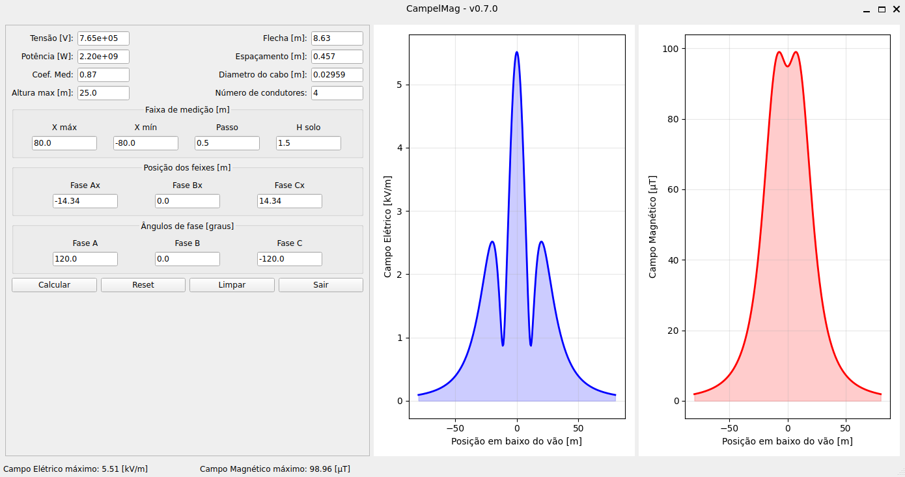
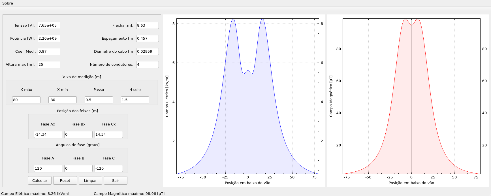

# Electric and Magnetic Fields Calculation from Transmission Lines

Cálculo de campos elétrico e magnético em linhas de transmissão de alta tensão.

Implementado em múltiplas linguagens e frameworks para fins educacionais e comparativos.

## 📋 Descrição

CampelMag é uma ferramenta para calcular campos elétricos e magnéticos gerados por linhas de transmissão de alta tensão, baseado no livro:

**EPRI AC - Transmission Line Reference Book - 200kV and above**
Capítulo 7 - Electric and Magnetic Fields

## 🚀 Implementações Disponíveis

### 1. Python (Biblioteca)

Implementação pura em Python com NumPy e SciPy.

📁 **Pasta:** `python/`

```bash
cd python
pip install -r requirements.txt
python LT-3F-765kv.py
```

[Documentação completa](python/README.md)

---

### 2. PySide6 (Interface Gráfica) ⭐ NOVO

Interface gráfica moderna com PySide6 integrando a lógica Python.

📁 **Pasta:** `pyside/`

```bash
cd pyside
# Windows
setup.bat

# Linux/macOS
bash setup.sh

# Executar com uv (recomendado)
uv run campelmag-gui
```

**Características:**

- Interface gráfica intuitiva
- Gráficos interativos com matplotlib
- Cálculo em tempo real
- Visualização de campos E e B
- ⚡ Usa [uv](https://github.com/astral-sh/uv) para gerenciamento rápido de pacotes

[Guia Rápido](pyside/QUICKSTART.md) | [Guia do UV](pyside/UV_GUIDE.md) | [Documentação completa](pyside/README.md)

---

### 3. Qt/C++

Interface gráfica nativa em C++ com Qt5 e QCustomPlot.

📁 **Pasta:** `Qt/`

```bash
cd Qt/Campelmag
qmake
make
./Campelmag
```

**Requisitos:**

- Qt5
- Eigen3
- QCustomPlot

---

### 4. C++

Implementação em C++ puro com geração de gráficos via gnuplot.

📁 **Pasta:** `c++/`

```bash
cd c++/campelmag
make
./campelmag
```

**Requisitos:**

- Eigen3
- gnuplot

---

### 5. Julia

Implementação em Julia para computação científica de alto desempenho.

📁 **Pasta:** `julia/`

```julia
using Pkg
Pkg.activate(".")
Pkg.instantiate()
include("LT-3F-765kv.jl")
```

[Documentação completa](julia/README.md)

---

### 6. Rust

Implementação em Rust com foco em performance e segurança.

📁 **Pasta:** `rust/`

```bash
cd rust
cargo run --example lt_765kv
```

---

## 📊 Comparação de Implementações

| Linguagem   | Interface | Gráficos    | Facilidade | Performance |
| ----------- | --------- | ----------- | ---------- | ----------- |
| **Python**  | CLI       | matplotlib  | ⭐⭐⭐⭐⭐ | ⭐⭐⭐      |
| **PySide6** | GUI       | matplotlib  | ⭐⭐⭐⭐⭐ | ⭐⭐⭐      |
| **Qt/C++**  | GUI       | QCustomPlot | ⭐⭐⭐     | ⭐⭐⭐⭐⭐  |
| **C++**     | CLI       | gnuplot     | ⭐⭐       | ⭐⭐⭐⭐⭐  |
| **Julia**   | CLI       | Plots.jl    | ⭐⭐⭐⭐   | ⭐⭐⭐⭐⭐  |
| **Rust**    | CLI       | plotters    | ⭐⭐⭐     | ⭐⭐⭐⭐⭐  |

## 🎯 Recomendações de Uso

- **Iniciantes**: Use **Python** ou **PySide6** (interface gráfica)
- **Produção**: Use **Qt/C++** ou **Rust**
- **Pesquisa/Academia**: Use **Julia** ou **Python**
- **Performance crítica**: Use **Rust** ou **C++**

## 📸 Screenshots

### Interface PySide6



### Interface Qt/C++



## 🔧 Funcionalidades Principais

- ✅ Cálculo de campo elétrico (kV/m)
- ✅ Cálculo de campo magnético (µT)
- ✅ Suporte a feixes de condutores
- ✅ Configuração de múltiplas fases
- ✅ Perfil de medição customizável
- ✅ Visualização gráfica dos resultados
- ✅ Cálculo de efeito corona (em algumas versões)

## 📝 Parâmetros de Entrada

- Tensão da linha (V)
- Potência transmitida (W)
- Altura e flecha dos condutores (m)
- Configuração do feixe (espaçamento, diâmetro, quantidade)
- Posição e ângulos das fases
- Faixa de medição

## 📚 Referências

- EPRI AC Transmission Line Reference Book - 200kV and above
- Electric and Magnetic Fields (Chapter 7)

## 👨‍💻 Autor

**Alan Franco**
📧 Email: [contato]
📅 Data: 03/08/2016 (versão original)

## 📄 Licença

MIT License - veja o arquivo [LICENSE](LICENSE) para detalhes.

## 🤝 Contribuições

Contribuições são bem-vindas! Sinta-se à vontade para:

- Reportar bugs
- Sugerir novas funcionalidades
- Melhorar a documentação
- Adicionar novos exemplos

## 📈 Roadmap

- [ ] Interface web (React/WebAssembly)
- [ ] API REST
- [ ] Suporte a múltiplos circuitos
- [ ] Análise de harmônicos
- [ ] Exportação de relatórios PDF
